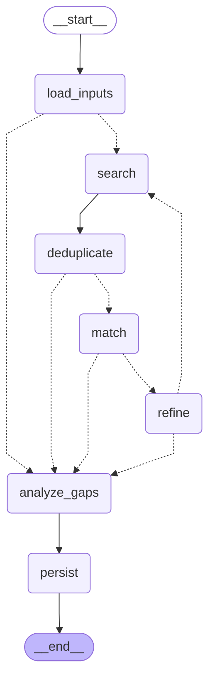
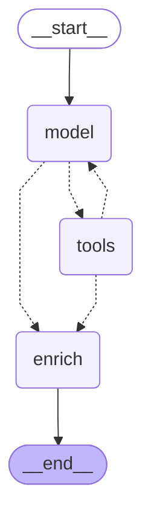

# Developer guide

Run all commands from the repository root. [README.md](README.md) provides the
project overview; [AGENTS.md](AGENTS.md) contains coding-agent instructions.
This guide describes the current implementation and its supported workflows.

## Contents

- [Setup](#setup)
- [Input authority](#input-authority)
- [Configuration](#configuration)
- [Run the application and use refinement](#run-the-application-and-use-refinement)
- [Outputs and progress](#outputs-and-progress)
- [Job details and URL guardrail](#job-details-and-url-guardrail)
- [Langfuse infrastructure](#langfuse-infrastructure)
- [Prompt management](#prompt-management)
- [Matcher evaluations](#matcher-evaluations)
- [Troubleshooting](#troubleshooting)
- [Development checks](#development-checks)
- [Architecture and code-reading guide](#architecture-and-code-reading-guide)
- [Generated graph topology](#generated-graph-topology)
- [Historical runtime records](#historical-runtime-records)

## Setup

1. Install Python 3.12 or later and `uv`. Docker with Compose is needed only for
   the optional local Langfuse stack.
2. Install the project and Chromium:

   ```bash
   uv sync
   uv run playwright install chromium
   ```

3. On a new checkout, create `.env` from the tracked template. Preserve an existing
   `.env` rather than overwriting its credentials or infrastructure secrets:

   ```bash
   cp .env.example .env
   ```

4. Set `ANTHROPIC_API_KEY` for the default Anthropic models. Create the input directory
   and fill in the required, nonblank profile and criteria files:

   ```bash
   mkdir -p .input
   ```

   | File | Content |
   | --- | --- |
   | `.input/profile.md` | Candidate facts, skills, experience, residence, authorization, languages |
   | `.input/search_criteria.md` | Target work, requirements, preferences, engagements, rates, exclusions |
   | `.input/discard_keywords.txt` | Optional comma-separated advisory keyword hints |

5. Leave `BROWSER_HEADLESS=false` for the first run. Leave both Langfuse project keys
   blank to use local prompts without tracing, or complete the Langfuse setup below.
6. Run:

   ```bash
   uv run python main.py
   ```

   Complete LinkedIn login in the visible browser. The application can wait up to
   three minutes for manual login. Cookies are saved in `.state/cookies.json` and
   reused. Optional `LINKEDIN_EMAIL` and `LINKEDIN_PASSWORD` enable a credential
   attempt before manual login; MFA or other login checks may still need interaction.
   Set `BROWSER_HEADLESS=true` only after authentication works.

`main.py` has no command-line option parser; configure it with environment variables
rather than flags. `uv sync` uses `pyproject.toml` and `uv.lock`; the default development
option includes Ruff and pytest, although repository instructions do not require adding tests.

## Input authority

Profile and search criteria are passed in full to all four model components. Profile
facts do not automatically become job requirements; desired skills do not prove the
candidate has them. Change profile for candidate facts and criteria for selection policy.
Discard keywords are lowercased comma-separated hints, loaded once by the coordinator,
not automatic title exclusions or proof of missing skills. Generated advice and scraped
text cannot override either input file. Browser filters and budgets restrict discovery
independently of policy, so search cannot promise coverage of jobs excluded by filters.

Model prompts ask for this precedence, but do not guarantee model compliance. Response
schemas and ID checks validate structure; evaluation measures decisions against reviewed
labels. Skills-gap analysis aggregates supplied missing-skill evidence rather than
inventing gaps from rejected roles. Its local prompt uses frequency-based High/Medium/Low
priorities when the input files do not specify different priorities.
The baseline asks for High at 30% or more of jobs or for requirements of top-scoring
jobs, Medium at 10–29%, and Low below 10%. These are model instructions, not a
deterministic priority calculation; a selected remote prompt may change them.

## Configuration

Model names and tuning values have defaults in [config/settings.py](config/settings.py); add environment
overrides only when needed. Process environment variables override `.env`, which overrides
the code defaults. Optional LinkedIn credentials are unnecessary for manual login or saved cookies.

| Variable | Default / requirement | Description |
| --- | --- | --- |
| `ANTHROPIC_API_KEY` | required for Anthropic models | Anthropic API key; validated when constructing an Anthropic model |
| `LANGFUSE_PUBLIC_KEY` | empty | Langfuse project public key; set together with the secret key to enable tracing |
| `LANGFUSE_SECRET_KEY` | empty | Langfuse project secret key; both keys blank disables tracing |
| `LANGFUSE_BASE_URL` | `http://localhost:3000` | Langfuse endpoint; match the web service's port |
| `PROMPT_LABEL` | `production` | Langfuse release label used by all agents; matcher evaluations can override it with `--prompt-version` |
| `ORCHESTRATOR_MODEL` | `claude-haiku-4-5-20251001` | Model for LLM search-param refinement |
| `SEARCH_MODEL` | `claude-haiku-4-5-20251001` | Model for the Search Agent |
| `MATCHER_MODEL` | `claude-haiku-4-5-20251001` | Model for the Matcher Agent |
| `SKILLS_GAP_MODEL` | `claude-haiku-4-5-20251001` | Model for the Skills Gap Agent |
| `BROWSER_HEADLESS` | `false` | Run browser headlessly (set `true` after first login) |
| `BROWSER_SLOW_MO` | `800` | ms between browser actions (anti-bot detection) |
| `LINKEDIN_EMAIL` | — | Optional: email for auto-login |
| `LINKEDIN_PASSWORD` | — | Optional: password for auto-login |
| `MAX_JOBS_PER_SEARCH` | `20` | Max job cards scraped per `scrape_jobs` call |
| `MAX_TOTAL_JOBS` | `25` | Hard cap on total jobs collected per iteration |
| `JOB_DETAIL_DELAY_MS` | `4000` | Pause between fetching each job detail page |
| `MATCHER_BATCH_SIZE` | `15` | Jobs per matcher LLM call |
| `MATCHER_MAX_CONCURRENCY` | `1` | Maximum simultaneous matcher requests; set `2` to overlap independent batches |
| `MATCHER_DESCRIPTION_CHARS` | `7000` | Maximum description characters sent to the matcher per job |
| `MAX_REFINEMENT_ITERATIONS` | `1` | Maximum search/match passes; refinement runs only between passes |
| `ORCHESTRATOR_TIMEOUT` | `600.0` | Soft deadline for starting searches/refinements (seconds) |
| `SEARCH_LOCATIONS` | `Remote` | Comma-separated starting locations; refinement can propose additional regions |
| `SEARCH_DATE_POSTED` | `past_week` | URL-level recency filter |
| `SEARCH_WORK_MODES` | `remote` | Comma-separated URL-level work-mode filters |
| `SEARCH_JOB_TYPES` | `contract,temporary,part-time` | Comma-separated URL-level job-type filters |
| `OUTPUT_DIR` | `.output` | Parent directory for timestamped run folders |

Job limits, matcher batch size, description length, iteration count, and timeout must be
positive. Matcher concurrency must also be positive. Timeout must be finite.
Browser slowdown and detail delay may be zero, but not
negative. Description length cannot exceed the scraper's 8,000-character cap. Pydantic
checks these constraints when settings load.

Model settings accept bare Claude names (Anthropic by default) or LangChain
`provider:model` names. Other providers require their integration package and
credentials exported in the shell; arbitrary provider credentials in `.env` are
not loaded by this application's settings. Search requires tool calling; refinement
and skills-gap analysis use function-calling structured output. Matcher uses native
`json_schema` structured output. Select a model/integration supporting its stage's
method. The default remains Anthropic for every stage.
See [model construction](#architecture-and-code-reading-guide) for details.

Langfuse settings are passed explicitly to the SDK; no shell export is needed.
See [Langfuse infrastructure](#langfuse-infrastructure) for setup and tracing,
[prompt management](#prompt-management) for publishing and runtime selection, and
[matcher evaluations](#matcher-evaluations) for dataset imports and evaluation options.
With both keys blank, tracing is disabled and application agents load their local JSON prompts.

### Input/state path overrides

The following settings also exist in `config/settings.py`; they use these defaults
and can be overridden through Pydantic settings even though `.env.example` does not
list them. Relative paths are resolved from the working directory.

| Variable | Default |
| --- | --- |
| `PROFILE_PATH` | `.input/profile.md` |
| `SEARCH_CRITERIA_PATH` | `.input/search_criteria.md` |
| `DISCARD_KEYWORDS_PATH` | `.input/discard_keywords.txt` |
| `SEARCH_GUIDANCE_PATH` | `.state/search_guidance.json` |
| `SEARCH_GUIDANCE_VIEW_PATH` | `.state/search_params.md` |
| `COOKIES_PATH` | `.state/cookies.json` |

Supported search recency values are `past_day`, `past_week`, `past_month`, and
`any_time`. Work modes are `remote`, `hybrid`, and `on-site`; job types are
`full-time`, `part-time`, `contract`, `temporary`, `internship`, and `volunteer`.
Work modes and job types accept comma-separated values; empty strings omit those
URL filters. The code maps recognized values to LinkedIn filter codes.

## Run the application and use refinement

```bash
uv run python main.py

# Example: permit two search/match passes, with refinement between them.
MAX_REFINEMENT_ITERATIONS=2 uv run python main.py

# Example: reduce the collection cap for a quick functional run.
MAX_TOTAL_JOBS=2 uv run python main.py
```

Process environment overrides `.env`, which overrides settings defaults. These
commands still browse LinkedIn and call models; small limits are caps, not promised
result counts. Each search pass has at most
`ceil(MAX_TOTAL_JOBS / MAX_JOBS_PER_SEARCH)` listing calls and 15 search-model calls.
Tool calls from the last model response still execute before final enrichment.
The search stop reason is `search_budget`, `model_call_limit`, or `model_finished`.

`MAX_REFINEMENT_ITERATIONS=1` means one search pass and no refinement. Additional
passes match only new IDs. An empty result or a pass containing only already-seen
IDs ends the loop. Refinement happens before final skills analysis, so it receives
match examples rather than computed skill gaps. The soft deadline is checked before
new search/refinement and after refinement. Ongoing browser/model calls are not
interrupted; a started search finishes and its new jobs are matched.

Refinement returns a `SearchGuidance` with:

| Field | Validation / purpose |
| --- | --- |
| `keyword_groups` | 1–8 nonblank search keyword combinations in priority order |
| `location_priorities` | Nonblank regions; defaults to an empty list; additional regions are allowed |
| `insights` | Nonblank observations from matches |
| `reasoning` | Nonblank explanation of strategy changes |

Extra fields are forbidden. Date/work-mode/job-type filters remain fixed settings.
Duplicate locations are removed case-insensitively. Proposed regions come before
remaining configured locations: Europe/EMEA advice plus Netherlands configuration
produces Europe, EMEA, Netherlands. Discovery regions do not change candidate eligibility.

Coordinator saves `.state/search_guidance.json` and its Markdown view
`.state/search_params.md`. Later runs read only JSON. Missing JSON means use the base
criteria; invalid or blank JSON fails validation. Editing the Markdown view has no
effect. To temporarily return to criteria-only search while preserving advice, move
the canonical JSON aside if it exists:

```bash
mv .state/search_guidance.json .state/search_guidance.json.bak
```

Saved advice is reusable strategy, not interrupted execution progress. There is no
cross-run result cache, graph checkpointer, interrupted-run resume, or graph retry.

## Outputs and progress

Each invocation creates an exclusive folder using the run's start time, microseconds,
and session ID:

```text
.output/<timestamp>_<session-id>/
  matched_jobs.md
  skills_gap.md
  execution_trace.log
  token_usage.json
```

| File | Content |
| --- | --- |
| `matched_jobs.md` | Ranked jobs, scores, skills, reasons, bounded matcher context, per-pass guidance/filter snapshots, and refinement history |
| `skills_gap.md` | This run's missing skills by category, frequency, and priority |
| `execution_trace.log` | Stage events, model timing/usage, raw response/tool payloads, prompt selection, and guardrail decisions |
| `token_usage.json` | Completion status, provider-reported totals, and per-model/cache details; partial usage is saved after errors |

The two reports share the run's start timestamp. Reports are written only when the
workflow reaches persistence; an uncaught stage error stops remaining nodes. The
CLI handles missing inputs or failed LinkedIn authentication with guidance and exit
code 1, and displays/re-raises other errors. Failed runs retain their trace and any
reported usage. Existing run outputs are not overwritten.

The CLI consumes explicit stage/progress events for listing, detail enrichment,
matching, and other stages. Progress does not expose profile/model/job contents.
Matcher progress counts completed requests, which can subsequently fail validation.
The root usage callback aggregates by model; local per-call logging remains separate.
An empty usage map means no usage was reported, not proof of zero billing. This is
usage accounting, not a monetary cost estimate. The matched-job report includes
search criteria, guidance, and effective-filter snapshots; it does not retain the
full profile or discard hints. Actual executed queries and tool calls are in the trace.

## Job details and URL guardrail

Search cards supply initial job data. Shared detail fetching loads the stable search
results pane using the job ID while retaining the original `/jobs/view/` link.
It fetches the description and metadata, including the header location, then merges
nonblank fields without clearing existing values. The scraper caps descriptions at
8,000 characters; matcher context uses `MATCHER_DESCRIPTION_CHARS` (default 7,000).
Location in the header is evidence even if the description only says Remote.

Explicit detail requests must refer to a collected job. Both the tool and final
enrichment skip IDs processed in earlier passes and descriptions already collected.
Nonblank partial descriptions currently pass that presence check. `JobDetailError`
provides feedback to the model or an enrichment failure count; unexpected programming
errors propagate. Individual enrichment failures are logged while other jobs continue.
Deduplication uses LinkedIn IDs; different-ID recruiter reposts can remain.

Engagement extraction examines labeled lines and role-specific phrases, including
direct negation. Full-time/part-time allocation does not establish legal engagement:

| Evidence | Interpretation |
| --- | --- |
| Contractor assignment plus full-time commitment | Contract engagement; hours do not imply permanent employment |
| Explicit permanent employment | Permanent engagement |
| Bare full-time metadata | Engagement unresolved |
| Contradictory explicit contract/permanent statements | Unresolved, with conflicting evidence shown to matcher |
| Generic mention of contractors | Not proof of this role's engagement |

Unusual wording, complex negation, and other languages can remain unresolved.
Extracted engagement evidence is advisory, not a guarantee of independent B2B fit.
Matcher still reads the full supplied policy and bounded description.

`tools/url_guardrails.py` validates runtime-generated/retrieved URLs before navigation
and ID extraction. Only hostnames `linkedin.com` and `www.linkedin.com` are allowed.
Static feed/login URLs are not checked. This learning guardrail checks hostname only,
not scheme, port, path, or job existence. Rejections raise `URLValidationError`.

Local results appear as `guardrail_passed`/`guardrail_blocked` in the execution trace.
With tracing enabled, `linkedin_url_validation` observations are also exported inside
the Langfuse trace. Open Tracing and the run, or remove its root-only filter to find
nested guardrail observations. The check works without Langfuse; export failure does
not change enforcement.

## Langfuse infrastructure

This optional stack runs Langfuse web and worker with PostgreSQL, ClickHouse,
Redis, and MinIO. It follows the [official Docker Compose deployment](https://langfuse.com/self-hosting/deployment/docker-compose)
and currently uses Langfuse v4 images. The Python application uses the Langfuse SDK's
LangChain callback handler to trace the outer graph and nested model and tool calls.

Requires Docker with Compose and Python 3.12+ (already required by the project).
Give Docker enough memory for the six services.

### Start

Set infrastructure variables directly in the repository's root `.env`; the root
`.env.example` lists them. Compose refuses to start with missing secrets.

For a fresh environment, `.env.example` leaves `SALT`, `NEXTAUTH_SECRET`, and
`ENCRYPTION_KEY` blank. Generate separate random values and paste them into `.env`;
this command generates one 64-character hexadecimal value:

```bash
uv run python -c 'import secrets; print(secrets.token_hex(32))'
```

Run it separately for each secret. `ENCRYPTION_KEY` requires exactly 64 hexadecimal
characters. No initialization script is required. Keep secrets and credentials stable
when retaining volumes; changing them can prevent access to existing data. Changing
credentials alone does not migrate existing data.

The Compose password variables are `POSTGRES_PASSWORD`, `CLICKHOUSE_PASSWORD`,
`REDIS_AUTH`, and `MINIO_ROOT_PASSWORD`, each `langfuse` in the example. Usernames for
PostgreSQL, ClickHouse, and MinIO are fixed to `langfuse`; Redis uses a password.
`LANGFUSE_PORT` defaults to 3000 and `MINIO_PORT` to 9090. Only those ports are
published on 127.0.0.1; update `LANGFUSE_BASE_URL` when changing the web port.

From the repository root:

```bash
docker compose config --quiet
docker compose up -d
docker compose ps
docker compose logs -f langfuse-web langfuse-worker
```

Wait for web startup and migrations to finish, then open <http://localhost:3000>.
Sign up, create an organization, and create a project. There is no default account.
Create project API keys in the UI and set them directly in the root `.env`:

```dotenv
LANGFUSE_PUBLIC_KEY=pk-lf-...
LANGFUSE_SECRET_KEY=sk-lf-...
LANGFUSE_BASE_URL=http://localhost:3000
```

Run `uv sync`, then `uv run python main.py`. In your project's **Tracing** view, look for
`linkedin-job-search`; its session ID matches the run's output folder and local logs.
The callback captures graph state, model inputs/outputs, and tool calls, so traces
include profile, criteria, and job data. Pending events are flushed on success and
failure. Existing local logs and token reports continue to be written.

Leave both project keys blank to disable tracing. Setting only one is a configuration
error. If you change `LANGFUSE_PORT`, update `LANGFUSE_BASE_URL` to match.

Only the web UI/API (`3000`) and MinIO storage API (`9090`, used by browser media
uploads/downloads) are published, both on `127.0.0.1`. Databases and the worker
are reachable inside the Compose network. Edit `LANGFUSE_PORT` or `MINIO_PORT`
in the root `.env` if either port is occupied. Compose service URLs use these port
settings; set `LANGFUSE_BASE_URL` separately when changing `LANGFUSE_PORT`.
This setup is for local use.

### Operate

Run these commands from the repository root:

```bash
# Stop containers, retaining all data in named Docker volumes.
docker compose down

# Start again with the same credentials and volumes.
docker compose up -d

# Inspect dependency health and startup failures.
docker compose ps
docker compose logs --tail=100
```

`docker compose down -v` deletes the stack's stored data. Use it only for an
intentional reset. Container logs rotate at 10 MB with three files per service;
database and object storage volumes still grow as data accumulates.

The exact image tags are listed below; they can receive updates. For upgrades,
back up the data and `.env`, review Langfuse's
[upgrade guidance](https://langfuse.com/self-hosting/upgrade), then run
`docker compose pull` and `docker compose up -d`. This local stack does not provide
automated backups or high availability.

### Services and persistent data

| Compose service | Purpose |
| --- | --- |
| `langfuse-web` | UI and API; browser/authentication/configuration requests |
| `langfuse-worker` | Background processing of queued events and other work |
| `postgres` | Relational application data, including accounts, projects, prompts, and dataset configuration |
| `clickhouse` | Analytical trace/observation/score data |
| `redis` | Queue/cache infrastructure used by Langfuse |
| `minio` | S3-compatible storage for event and media objects |

Compose declares volumes for PostgreSQL, ClickHouse data/logs, Redis, and MinIO.
The web/worker images use Langfuse major version 4; PostgreSQL is 17, ClickHouse
25.12, Redis 7, and MinIO has no explicit tag (`latest`). Tags can receive updates;
they are not immutable digests. All services restart unless stopped. Docker container
logs rotate at 10 MB with three files per service; storage volumes can still grow.

## Prompt management

Each agent loads its own chat template through `prompts/prompt.py`. The JSON files
in `prompts/` provide the version-controlled baseline and local fallback. Langfuse
provides the runtime version selected by `PROMPT_LABEL`, which defaults to `production`.
Template variables and ownership are listed below.

Publish all `prompts/*.json` files through the API:

```bash
# Create candidate versions without moving a release label.
uv run python -m prompts.upload_prompts

# Publish and assign production to the new version of every prompt.
uv run python -m prompts.upload_prompts --label production

# Show supported options.
uv run python -m prompts.upload_prompts --help
```

| Option | Default | Behavior |
| --- | --- | --- |
| `--label LABEL` | omitted | Assign this label to every uploaded version; `production` activates them for the default runtime configuration |
| `-h`, `--help` | — | Print usage without uploading |

Both Langfuse project keys are required. Each invocation publishes a new version of
every JSON prompt in the folder, including unchanged prompts. Without `--label`, new
versions receive Langfuse's `latest` label but the production selection stays unchanged.
To promote an existing evaluated version, select it in Langfuse **Prompts** and move
the `production` label to it; rerunning the uploader publishes new versions instead.

If keys are absent, the selected prompt is missing, or fetching fails, application
agents use their local JSON template. The loader logs `prompt_fallback` and
`prompt_selected`, including the source, version, and content hash. Local fallback
uses version `0`; it is not a Langfuse version. Remote templates are linked to model
generations through the callback handler. Templates are fetched without SDK caching,
with no fetch retries and a three-second timeout. A selected template is reused for
that agent invocation; later invocations can select a newer labeled version.

### Prompt files and runtime selection

| Local template | Langfuse name | Variables / placeholders |
| --- | --- | --- |
| `prompts/matcher.json` | `job-matcher` | `profile`, `criteria`, `discard_keywords`, `jobs` |
| `prompts/search.json` | `job-search` | `messages`: conversation-history placeholder preserving human, assistant, and tool messages |
| `prompts/refinement.json` | `job-refinement` | `session_context` |
| `prompts/skills_gap.json` | `job-skills-gap` | `profile`, `criteria`, `results` |

The JSON format contains `name`, `type: "chat"`, and a `prompt` message list.
Message content uses Langfuse variables such as `{{profile}}`; history placeholders
use `{"type": "placeholder", "name": "messages"}`. The generic loader converts
these to LangChain templates. Input-formatting functions remain in the agents.

Each agent owns prompt loading. The coordinator supplies workflow inputs, not
templates. `prompts/prompt.py` loads the selected Langfuse version, logs its source,
version, and hash, and uses the local JSON when a fetch fails. Matcher validates
its required variable set and keeps its response-schema and job-ID checks in code.
The loader reads the local JSON before fetching the remote prompt, so keep the file
present and valid even when Langfuse supplies the runtime version. Malformed local files or incompatible matcher templates raise errors rather than
being repaired. The application can use a fallback; matcher evaluations require
the selected remote version. Fetching once per agent invocation also keeps matcher
batches and search's model/tool loop on the same template.

Git owns the reproducible local baseline; Langfuse owns the labeled runtime version.
Editing a local file does not change a remote version until it is uploaded, and
editing a prompt in Langfuse does not update the local fallback. See the
[upload commands and release labels](#prompt-management) and
[evaluation options](#matcher-evaluations).

## Matcher evaluations

`evals/golden_dataset.json` contains saved job inputs, profile and criteria snapshots,
reviewed expected decisions, and metadata. It is tracked in Git and does not depend
on `.output` or an earlier Langfuse installation. Its Langfuse dataset name remains
`job-matcher-baseline`. On a fresh or reset Langfuse instance, first create a project
and configure its API keys as described in [Langfuse setup](#langfuse-infrastructure).
Before running model evaluations, publish the remote prompts with the runtime label:

```bash
uv run python -m prompts.upload_prompts --label production
```

Dataset import and validation do not require a remote matcher prompt, but evaluation
with `--run` does: it never uses the local fallback. See [prompt management](#prompt-management)
for candidate versions and labels. Recreate the dataset:

```bash
uv run python -m evals.seed_matcher_dataset
uv run python -m evals.seed_matcher_dataset --file evals/golden_dataset.json
uv run python -m evals.seed_matcher_dataset --help
```

| Option | Default | Behavior |
| --- | --- | --- |
| `--file PATH` | `evals/golden_dataset.json` | Read the dataset seed from this JSON file; its `name` determines the Langfuse dataset |
| `-h`, `--help` | — | Print usage without importing |

Imports use stable item IDs, updating existing examples rather than duplicating them.
Examples omitted from a later seed file are not deleted from Langfuse by this command.
Importing does not call the model or rerun historical experiments. Update the local
file and reimport when correcting a label or input. Keep dataset inputs and labels
fixed when comparing prompt versions.

Validate or evaluate the dataset from the repository root:

```bash
# Validate active examples only: no model calls and no prompt fetch.
uv run python -m evals.evaluate_matcher

# Run the matcher using the currently selected prompt label.
uv run python -m evals.evaluate_matcher --run

# Evaluate an exact candidate version; replace 2 with the uploaded matcher version.
uv run python -m evals.evaluate_matcher --run --prompt-version 2

# Use a different dataset already stored in Langfuse.
uv run python -m evals.evaluate_matcher --dataset my-dataset --run
uv run python -m evals.evaluate_matcher --help
```

| Option | Default | Behavior |
| --- | --- | --- |
| `--dataset NAME` | `job-matcher-baseline` | Read active examples from this Langfuse dataset |
| `--run` | off | Call the matcher and publish an experiment; without it, only validate the dataset |
| `--prompt-version INTEGER` | omitted | With `--run`, use this exact matcher prompt version instead of resolving `PROMPT_LABEL` |
| `-h`, `--help` | — | Print usage without fetching or running |

Validation requires nonempty inputs, Boolean expected decisions, and
`metadata.reviewed=true`. A run evaluates each job separately, sequentially, using
its saved profile and criteria. It performs model calls but no LinkedIn browsing.
Langfuse keys are always required; model credentials are also required with `--run`.
The runner resolves the prompt once and pins its version across the experiment,
recording its name, version, source, and hash. Evaluations never silently fall back
to local prompts: an initial prompt-fetch failure stops the run, and a failure
while processing an item is recorded as an execution error.

### Scores and execution errors

Open **Experiments → Matcher baseline** in Langfuse. A recommendation of Strong Match
or Good Match maps to Yes; Weak Match or Skip maps to No. The expected answer is
`expected_output.worth_considering`. `decision_correct` is `1` for agreement and `0`
for disagreement or an execution failure. No judge model is used.

For valid predictions, TP means expected Yes/predicted Yes, FP means expected
No/predicted Yes, FN means expected Yes/predicted No, and TN means both are No.
Experiment-level numeric scores use the following definitions:

| Score | Calculation |
| --- | --- |
| `decision_accuracy` | `(TP + TN) / all items`, including errors in the denominator |
| `precision` | `TP / (TP + FP)` |
| `recall` | `TP / (TP + FN)` |
| `f1` | `2TP / (2TP + FP + FN)` |
| `execution_error_rate` | `error items / all items` |

Precision, recall, and F1 exclude execution errors; zero denominators return `0`.
Read these scores alongside the error rate, because excluding failed items can make
recall look better. Parsing failures, invalid job-ID coverage, and other task
exceptions return `{"error": "ExceptionType"}` and count as failed items. A valid
but incorrect decision affects classification metrics, not execution error rate.
Langfuse's built-in Error Count is separate from the custom `execution_error_rate`,
which is computed from task outputs. Inspect the item's trace and task output to
diagnose errors. Binary agreement does not
check the explanation, arithmetic, numeric match score, or whether No was expressed
as Weak Match instead of Skip. Existing experiments are not rescored automatically
when seed data or evaluation code changes.

## Troubleshooting

| Symptom | Check / action |
| --- | --- |
| Missing/blank profile or criteria | Fill the required input paths; optional discard hints can be absent |
| LinkedIn authentication fails | Set `BROWSER_HEADLESS=false`, rerun, and complete login; verify supplied login credentials if using them |
| Too few jobs | Check query overlap, listing budget, date/work-mode/job-type filters, and starting/guidance locations; the collection cap is not guaranteed yield |
| Location/description missing | Inspect report context and trace. Header extraction and nonblank merge are implemented, but LinkedIn markup/loading can yield incomplete data |
| Guidance does not reflect edited Markdown | Edit validated canonical JSON or move it aside; the Markdown file is only a view |
| Invalid saved guidance | Restore valid `SearchGuidance` JSON or move it aside; malformed JSON is not silently ignored |
| Local prompt unexpectedly used | Find `prompt_fallback`/`prompt_selected`; check project keys, endpoint, remote prompt name, and `PROMPT_LABEL` |
| Candidate prompt did not affect runtime | Upload without a label does not move production; assign the intended label in Langfuse |
| Search prompt conversion warns about unresolved `messages` | The history placeholder remains a LangChain placeholder at loading time and is filled by the search chain at invocation |
| No Langfuse observations | Check both project keys/base URL and the Tracing view; inspect flush/export logs; remove root-only filters for nested observations |
| Experiment has errors | Inspect the item's trace/output: parsing, duplicate/missing/unknown IDs, prompt-fetch, and provider failures are execution errors |
| Good binary metric but poor explanation | Binary scoring ignores arithmetic, rationale, score, and Weak-versus-Skip consistency; review traces before changing labels or prompts |
| High recall with failed tasks | Recall excludes execution errors; read it with `execution_error_rate` |
| Compose does not start | Use `docker compose config --quiet`, `docker compose ps`, and logs; required secrets may be missing or a host port occupied |

Correcting an input/label is different from improving the matcher. Review disagreement
cases before tuning instructions merely to satisfy the golden examples. Preserve
exact prompt versions and dataset snapshots when comparing experiments.

## Development checks

```bash
uv run ruff check .
uv run ruff format --check .
git diff --check

# Apply formatting when needed, then rerun the checks.
uv run ruff format .

# Regenerate current diagrams in this guide without model/browser calls.
uv run python -m scripts.export_graphs
```

The exporter takes no CLI options and updates only the marked generated section below.
`main.py` also has no CLI options. The prompt upload, dataset seed, and evaluation
modules accept the options listed in their respective sections and `--help`.
Do not add tests unless explicitly requested; use imports and relevant offline checks
alongside lint/formatting. Publishing prompts, importing data, running the application,
and using evaluation `--run` are operational actions, not offline verification.

## Architecture and code-reading guide

| Folder | Responsibility |
| --- | --- |
| `agents/` | Coordinator/search graphs, agent prompt loading and response validation, shared model client |
| `prompts/` | JSON baseline templates, Langfuse/local loader, API uploader |
| `evals/` | Golden dataset, seed command, experiment runner and metrics |
| `config/` | Environment and file-path settings |
| `domain/` | Pydantic models, engagement interpretation, job formatting, location ordering |
| `tools/` | Browser thread/lifetime, scraping, typed tools, shared details, URL validation |
| `storage/` | Reading inputs/advice and writing state/reports |
| `presentation/` | Rich terminal progress and Markdown rendering |
| `observability/` | Local logging, Langfuse callback lifecycle, guardrail export |
| `scripts/` | Compiled graph-diagram export |

Read the code in this order:

1. `main.py` and `agents/coordinator.py`: coordinator creates output/log/usage contexts,
   executes the graph, and adapts final state to `SearchSession`. No checkpointer or
   graph retries are configured. It streams custom stage/progress and root values in
   v2 format; nested graph values do not replace pipeline state. Accumulating lists
   return complete replacement lists, and search history is typed `SearchSnapshot` data.
2. `agents/search.py`, `tools/search_tools.py`, and `tools/browser_session.py`:
   search owns a separate graph invoked inside its node, with browser resources in
   `SearchContext`. The model is bound to static `SEARCH_TOOLS` without parallel tool
   calls. A sequential adapter submits one call at a time to `ToolNode`, applying
   `Command` state updates before the next call. `ToolRuntime` injects state/context
   outside the model-visible schema. Search state contains history, jobs by ID,
   scrape/model counters, and stop reason; token aggregation is outside that state.
   Exhausted listing budgets return tool feedback without navigation. Invalid
   arguments or unknown tools produce feedback; other tool execution failures propagate.
3. `tools/job_details.py`, `tools/linkedin.py`, and `domain/employment.py`: browser
   operations run on one sync Playwright worker thread, including setup and cleanup.
   Copied context propagates logging/progress. Shared details/engagement handling serves
   both explicit tools and final enrichment; no duplicate browser-fetch policy.
4. `agents/matcher.py`, `agents/refinement.py`, and `agents/skills_gap.py`: all use
   `create_chat_model`, shared parsing, and agent-owned prompts. Matcher batches requests
   using `batch_as_completed` with configurable concurrency, then restores batch order.
   Results within each batch retain model response order.
   It rejects duplicate input IDs and missing/unknown/duplicate response IDs. Refinement
   normalizes its validated guidance; skills analysis converts validated gap items.
5. `agents/model_client.py`, `prompts/prompt.py`, and `observability/langfuse.py`:
   LangChain `init_chat_model` constructs provider clients. Native JSON schema is used
   for matcher, function calling for refinement/skills, and tool calling for search.
   `include_raw=True` preserves provider output and parser errors. Validation checks
   type/coverage, not business correctness. Prompt metadata links remote versions to
   generations; scoped Langfuse callbacks flush on success/failure without replacing
   the original result or exception. Restore prior log/trace contexts on exit.
6. `storage/reader.py`, `storage/writer.py`, `domain/models.py`, and
   `presentation/reports.py`: domain/presentation do not read configuration or write
   files. Coordinator passes typed data, storage owns paths/writes, and renderers take
   explicit options. Pydantic schemas distinguish job evidence, matches, gaps, guidance,
   snapshots, and sessions. Reports retain provenance and refinement objects, not
   generic notifications or duplicated Markdown advice in graph state.

`UsageMetadataCallbackHandler` is attached to the root graph alongside optional
Langfuse callbacks, propagating to nested chains and matcher worker threads. Usage
is aggregated by model and saved on successful and failed runs. `ModelLoggingCallback`
separately logs timing, errors, and raw text/tool responses. Rich progress is driven
by explicit events rather than fabricated counts. These component boundaries replace
older custom parsing, duplicate state, manual search-only token totals, and title-based
keyword rejection; those older paths are not current behavior.

## Generated graph topology

Refresh the following diagrams using `uv run python -m scripts.export_graphs`.
These show actual compiled nodes/routing; the overview diagram in README is conceptual.

<!-- BEGIN GENERATED GRAPHS -->

### Coordinator graph



### Search graph



<!-- END GENERATED GRAPHS -->

## Historical runtime records

The earlier documentation recorded two successful runs on 2026-09-10. These records
predate current detail-fetch/prompt policies and are retained as historical information,
not verified benchmarks or forecasts for the current application.

<details>
<summary>Earlier measurements and planning assumptions</summary>

### Measured runs

The first recorded Agentic AI contract search used a 1,126-word profile and 898-word
search criteria:

| Date | Search window | Max jobs / per search | Queries | Unique / enriched jobs | Matcher batches | Total |
| --- | --- | ---: | ---: | ---: | ---: | ---: |
| 2026-09-10 | Past month, EU + Netherlands | 30 / 10 | 3 | 20 / 19 | 2 | 179.4 s (2m 59s) |
| 2026-09-10 | Past month, EU + Netherlands | 150 / 20 | 8 | 80 / 74 | 4 | 706.6 s (11m 47s) |

Recorded average: **443.0 seconds (7m 23s) across two successful measured runs**. Because
the runs inspected different numbers of jobs, the pooled end-to-end throughput of **8.9 seconds
per unique job** accounts for the differing job counts. The earlier documentation used
these as planning guides; they are not current forecasts. LinkedIn yield and model
latency vary between runs.

The earlier documentation recorded this breakdown for the 20-job run:

| Stage | Observed time | Notes |
| --- | ---: | --- |
| Startup, cookie login, initial agent planning | 7.5 s | Existing authenticated cookie, headless browser |
| Three listing searches | 47.4 s | Individual searches took roughly 10–27 s depending on pagination |
| Enrich 19 job descriptions | 93.8 s | 4.9 s/job with `JOB_DETAIL_DELAY_MS=3000` |
| Match 20 jobs in batches of 15 + 5 | 28.6 s | 16,332 input and 2,768 output tokens across both calls |
| Skills-gap analysis and output writing | 2.0 s | One LLM call plus local Markdown writes |

The 80-job run spent 7.5 s on startup, 142.8 s on eight listing searches, 400.1 s enriching 74
descriptions (5.4 s/job), 140.4 s on four 20-job matcher batches, and 15.9 s on skills-gap
analysis/output. It produced 18 Strong, 13 Good, 2 Weak, and 47 Skipped results. Recruiter
reposts with different LinkedIn IDs mean these category counts are not counts of unique roles.

### Earlier planning estimates (not current guarantees)

The earlier documentation proposed this rough estimate for one search/match iteration:

```text
8 seconds startup
+ 10–30 seconds per scrape_jobs call
+ enriched jobs × (JOB_DETAIL_DELAY_MS / 1000 + about 2 seconds browser overhead)
+ 7–45 seconds per matcher batch
+ 2–20 seconds for skills-gap analysis and output
```

For the measured machine and input size, the earlier documentation proposed these
planning ranges; they have not been revalidated for the current application:

| Run profile | Suggested settings | Expected time |
| --- | --- | ---: |
| Quick check | 10 total jobs, 10/search, 3 s detail delay, 1 iteration | 1–2 minutes |
| Balanced deep search | 30 total jobs, 10/search, 3 s delay, batch 15, 1 iteration | 3–5 minutes |
| Larger deep search | 45 total jobs, 15/search, 3–4 s delay, batch 15, 1 iteration | 5–8 minutes |
| Broad campaign | 150 total jobs, 20/search, 3 s delay, batch 20, 1 iteration | 15–25 minutes |

Increasing `MAX_REFINEMENT_ITERATIONS` repeats search, enrichment, and matching, so two
iterations can approach twice the single-iteration runtime. `ORCHESTRATOR_TIMEOUT` is a soft
deadline checked between coordinator stages; it cannot interrupt a browser or API call already
in progress, so it should not be treated as a strict process timeout.

To update the average after future runs, record `latency_ms` from the final
`coordinator_complete` event together with query count, unique/enriched jobs, matcher batch size,
and the relevant settings. Comparing runs without those inputs is misleading.

</details>
