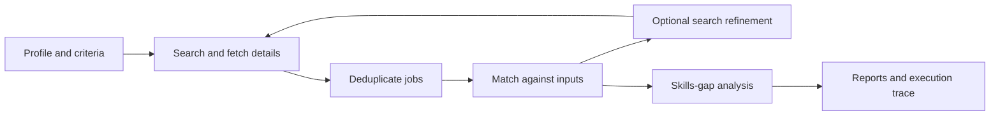

# LinkedIn Job Search Agents

A Python application that searches LinkedIn, evaluates jobs against your profile
and search criteria, and reports relevant opportunities and missing skills. It uses
LangGraph for workflows, LangChain for model integration, and Playwright for browsing.
The default model provider is Anthropic.

## How it works

1. Load your profile, search criteria, optional keyword hints, and saved search guidance.
2. Search LinkedIn through a model-driven browser-tool workflow and collect job details.
3. Deduplicate by LinkedIn job ID and match new jobs against your inputs.
4. If another search pass is allowed, generate and save improved search guidance.
5. Analyze missing skills across the matches and write reports in a new run folder.

Your profile defines candidate facts; the criteria define what jobs you want.
Generated advice helps discovery but cannot redefine those inputs. The default is
one search pass. Additional passes can expand search terms and locations without
changing geographic eligibility or other requirements.

Search is the component that chooses browser tools. Matching, refinement, and
skills analysis are model-powered workflow steps with structured responses.
The application checks response structure and job-ID coverage, but those checks
do not guarantee that a model interpreted every criterion correctly.

## Observability and evaluation

An optional local Langfuse stack records graph, model, tool, and URL-guardrail activity.
Each agent fetches its own versioned prompt from Langfuse, with a JSON template as
local fallback. A tracked golden dataset supports repeatable matcher experiments,
reporting accuracy, precision, recall, F1, and execution error rate.

Successful runs write matched-job and skills-gap reports, an execution trace, and
provider-reported token usage under `.output/`. Failed runs retain their execution
trace and any reported usage. Saved guidance can be reused by future runs;
interrupted runs cannot be resumed.

## Project documentation

- [DEVELOPMENT.md](DEVELOPMENT.md): setup, configuration, every developer command and option, operating workflows, architecture, and troubleshooting.
- [AGENTS.md](AGENTS.md): instructions and standards for coding agents working in this repository.
- [CLAUDE.md](CLAUDE.md): reference to the shared agent instructions.
