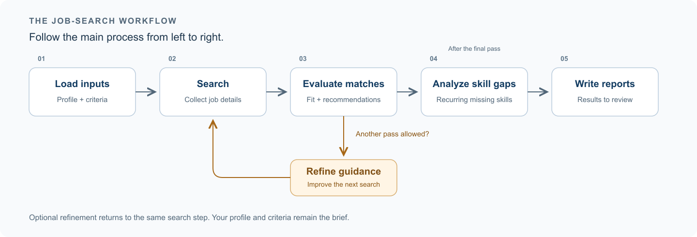
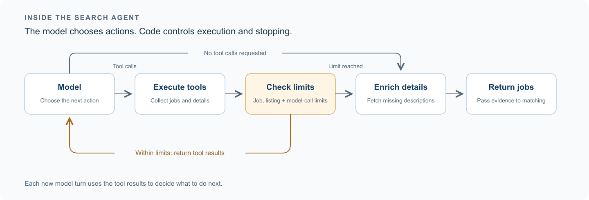
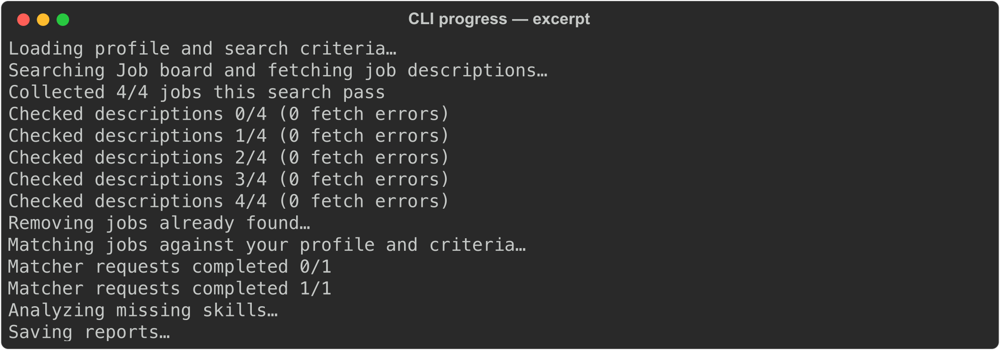
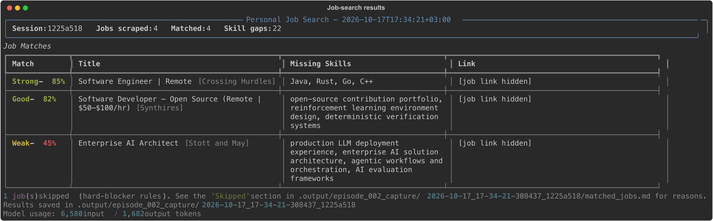

# Pragmatic AI - Agentic Workflow Series #2: Orchestration with LangGraph & LangChain

In episode one, I introduced a job-search system and a familiar frustration: a promising job spec can become irrelevant with a single sentence about residence, engagement, or eligibility.

Once you decide to build a solution for this, it is tempting to start with a framework and a model.

I started with a question instead:

**Which decisions should the agent make, and which should stay in code?**

You already know the basic process: search, collect details, evaluate opportunities, and review the results. What varies is the language, the evidence, and the interpretation needed along the way.

That distinction shaped the architecture before I chose the tools.

---

**The starting point: profile and search criteria**

Your profile and your search criteria answer different questions: what can you demonstrate, and what are you looking for?

I kept them in separate files. The profile holds experience, demonstrated skills, residence, and work authorization. The search criteria describe target roles, requirements, preferences, and exclusions.

That simple separation matters. If you want to move into a role involving Kubernetes, the system needs to understand the ambition without treating it as evidence that you already have the experience.

**From job listings to recommendations**

Employers use different titles and wording for similar work. A fixed query can miss a relevant role simply because the company describes it differently. The search agent can explore those variations, choosing search terms and requesting tools to collect listings and job details, guided by your profile and criteria.

The application controls the boundaries: available tools, allowed navigation hosts, collection budgets, and the maximum number of model calls. It executes the requested tools in sequence, passing their results back to the agent.

Once the evidence is collected, the matcher agent takes over. It evaluates the supplied jobs without browsing and returns a score, recommendation, matching and missing skills, and an explanation for each one.

Take the Swiss vacancy from episode one. The relevant question is whether its residence requirement fits your circumstances. Another description might advertise a full-time commitment without specifying permanent employment—a distinction that matters if you're looking for contract work. The matcher interprets those details against your requirements, giving you a recommendation you can inspect.

Keeping discovery and evaluation separate also makes mistakes easier to investigate. Was an important requirement missing from the collected description, or did the matcher receive it and misinterpret it? Each answer points to a different part of the system.

The matches can also reveal problems with the search strategy. When another pass is enabled, a refinement agent uses the results to propose keyword groups and location priorities. That gives the next search a different approach while keeping your original requirements as the brief.

The skills-gap agent then groups missing-skill evidence across the evaluated jobs by category, frequency, and priority. That includes weak matches and skipped opportunities, so a recurring gap needs context: does it appear in work you want to pursue, or mostly in roles that were unsuitable for other reasons?

The report brings these two perspectives together: which opportunities deserve a closer look, and which recurring skill requirements might be worth investigating next.

---

**Building the workflow with LangGraph and LangChain**

With the brief established, the workflow looks like this:



The first version of this project was plain Python, with direct SDK calls to the LLM providers. I controlled every component and how they connected: building requests, handling responses, dispatching tools, and passing data between steps. I even wrote the loops myself. That made it easy to experiment and understand what each part was doing.

As the workflow grew, that control came with more code to maintain. A change to one step could affect the state passed to the next, the conditions for another search pass, or the handling of a tool response. Following the execution meant tracing those connections through the Python code yourself.

That experience clarified what I needed from a framework: shared state, explicit conditional paths, a search agent loop, and consistent ways to work with models and structured responses. I also wanted a familiar ecosystem I could carry into other projects.

LangGraph and LangChain covered those needs. You still own the application logic, but you have a common structure for connecting its parts and following what happens between them.

**[LangGraph](https://docs.langchain.com/oss/python/langgraph/overview) manages that orchestration**. Each step is a node, shared state carries the data between nodes, and edges define where execution can go next.

Here's what that looks like in our workflow coordinator. The code defines both fixed transitions and conditional routes:

```python
def build_graph() -> CompiledStateGraph:
    graph = StateGraph(PipelineState)
    graph.add_node("load_inputs", _load_inputs)
    graph.add_node("search", _search_jobs)
    graph.add_node("deduplicate", _deduplicate_jobs)
    graph.add_node("match", _match_jobs)
    graph.add_node("refine", _refine_params)
    graph.add_node("analyze_gaps", _analyze_gaps)
    graph.add_node("persist", _persist_reports)

    graph.add_edge(START, "load_inputs")
    graph.add_conditional_edges("load_inputs", _route_after_load)
    graph.add_edge("search", "deduplicate")
    graph.add_conditional_edges("deduplicate", _route_after_deduplication)
    graph.add_conditional_edges("match", _route_after_matching)
    # Refinement can consume the remaining time: check again before searching.
    graph.add_conditional_edges("refine", _route_after_load)
    graph.add_edge("analyze_gaps", "persist")
    graph.add_edge("persist", END)
    return graph.compile()
```

The nodes and routes are ordinary Python functions. For example, `_match_jobs` passes the new jobs and user inputs to the matcher, then returns the updated list of matches:

```python
def _match_jobs(state: PipelineState) -> dict:
    new_matches = matcher.run(
        state["new_jobs"], state["profile_md"], state["criteria_md"]
    )
    return {"matched_jobs": state["matched_jobs"] + new_matches}
```

A routing function returns the name of the next node. Here's `_route_after_load`, together with the helper that checks the search-pass limit and soft deadline:

```python
def _can_search(state: PipelineState) -> bool:
    if state["iteration"] >= settings.max_refinement_iterations:
        return False
    if time.monotonic() > state["deadline"]:
        return False
    return True


def _route_after_load(state: PipelineState) -> Literal["search", "analyze_gaps"]:
    return "search" if _can_search(state) else "analyze_gaps"
```

There are two loops here, operating at different levels.

The **workflow loop** runs a search pass, evaluates the new jobs, and can refine the guidance before another pass.

The **search agent loop** happens inside each search pass: the agent requests tools, receives their results, and decides what to do next. A single search pass can contain several of these turns.

By default, the workflow runs one search pass, so there is no refinement. When additional passes are enabled, the workflow loop stops if no new job IDs appear or its pass limit is reached. A soft deadline prevents starting further searches or refinement; an in-flight search still finishes and its new jobs are matched. The search agent loop has its own collection budgets and model-call limit.



On each turn, the search agent uses its underlying LLM to interpret the tool results and choose the next action. The model call is one part of the agent; the graph connects it to tool execution and enforces the limits. Keeping this loop separate from the workflow loop lets you change how the agent searches without redesigning the whole application.

Here's how we define the search agent's graph, with the model-call, tool-execution, and enrichment functions:

```python
graph = StateGraph(SearchState, context_schema=SearchContext)
graph.add_node("model", call_model)
graph.add_node("tools", execute_tools)
graph.add_node("enrich", enrich)
graph.add_edge(START, "model")
graph.add_conditional_edges("model", route_after_model)
graph.add_conditional_edges("tools", route_after_tools)
graph.add_edge("enrich", END)
return graph.compile()
```

After the tools finish, this function decides whether the search agent can take another turn. If the collection budget or model-call limit has been reached, it moves to enrichment instead:

```python
def route_after_tools(state: SearchState) -> Literal["model", "enrich"]:
    if _budget_reached(state) or state["model_calls"] >= _MAX_MODEL_CALLS:
        return "enrich"
    return "model"
```

Enrichment attempts to retrieve any descriptions still missing from the collected listings, giving the matcher more complete evidence to work with.

**[LangChain](https://docs.langchain.com/oss/python/langchain/overview) supplies the components that connect each agent to its LLM**: model initialization, prompts, messages, tool binding, and structured responses.

For the search agent, you need to make the available tools visible to the LLM. `StructuredTool` describes each tool and its arguments, while `bind_tools` attaches those definitions to the model. Here is a simplified example using our default Anthropic provider, with logging omitted:

```python
from langchain.chat_models import init_chat_model
from langchain_core.tools import StructuredTool

SEARCH_TOOLS = (
    StructuredTool.from_function(scrape_jobs, args_schema=ScrapeJobsInput),
    StructuredTool.from_function(get_job_details, args_schema=JobDetailsInput),
)

search_model = init_chat_model(
    model=settings.search_model,
    model_provider="anthropic",
    api_key=settings.anthropic_api_key,
    max_tokens=2048,
).bind_tools(SEARCH_TOOLS, parallel_tool_calls=False)
```

That gives the search agent a defined set of actions to request. The application still executes those requests through the search graph you saw above.

The matcher agent needs a different response: a consistent set of fields that the workflow can process. It uses its own LLM instance with `with_structured_output` and the Pydantic schema `MatchesResponse`. It also loads its instructions through `get_prompt`, rather than hardcoding the prompt text into the agent. Passing `prompt_version` lets you select a specific version and compare changes without rewriting the agent logic:

```python
matcher_model = init_chat_model(
    model=settings.matcher_model,
    model_provider="anthropic",
    api_key=settings.anthropic_api_key,
    max_tokens=4096,
)
structured_model = matcher_model.with_structured_output(
    MatchesResponse, method="json_schema", include_raw=True
)
prompt = get_prompt(version=prompt_version, allow_fallback=allow_prompt_fallback)
chain = prompt | structured_model
```

The `|` connects the selected prompt to the configured model as a runnable chain. `MatchesResponse` defines the expected fields, and `include_raw=True` retains the original response alongside the parsed result. The next step can work with structured data instead of extracting recommendations from free-form prose.

---

**The workflow in action**

For this demonstration, I used a fictional candidate looking for remote contract work. These excerpts give you the essentials of the profile and search criteria:

> **Profile:** Backend engineer based in the Netherlands, with six years of experience building Python APIs, PostgreSQL-backed services, Docker deployments, and CI/CD pipelines. Has experimented with building an LLM application that retrieves information to support its answers.

> **Search criteria:** Remote work from the Netherlands must be permitted; contract or independent contractor engagement must be possible.

To keep the example small enough to inspect, I set `MAX_REFINEMENT_ITERATIONS=1` for one search pass and `MAX_TOTAL_JOBS=4` for a maximum of four collected jobs. You configure these limits through environment variables.

The search agent chose “Python backend engineer contract” with the Netherlands as the location. In the CLI, you can follow the handoffs from search to matching and skills-gap analysis:



The run returned one Strong, one Good, one Weak, and one Skip recommendation. The CLI table shows the first three, while the saved report also includes the skipped role and its explanation.



The report lets you look beyond the scores. Each result includes the matcher agent’s explanation, matching and missing skills, and the job context it received. These two excerpts show why it recommended one role and skipped another:

> **Software Engineer | Remote @ Crossing Hurdles**
>
> Score: 85% | Location: EMEA | Mode: remote
>
> Reason: Strong backend Python and API experience directly matches core requirements. Contract remote role permits engagement model. Missing experience in other listed languages, but Python is primary focus and present.
>
> Matching: Python, backend development, APIs, debugging, code review, performance optimization
>
> Missing: Java, Rust, Go, C++, TypeScript
>
> **Skipped: Platform Engineer - AWS / Kubernetes / Terraform @ Understanding Solutions**
>
> Score: 25% | Location: European Union | Mode: remote
>
> Reason: Role explicitly requires 5+ years platform/DevOps/SRE and strong production Kubernetes, AWS, and Terraform expertise. Candidate's background is backend Python APIs and Docker, not infrastructure engineering or cloud platform operations. No demonstrated Kubernetes or production AWS infrastructure experience.

Both roles mention Python. The explanations show how the matcher agent weighed that overlap against the broader experience each role requires.

The skills-gap agent groups the missing-skill evidence across the evaluated jobs into a separate report. Here are three entries from its AI Operations category:

| Skill | Frequency | Priority |
|-------|-----------|----------|
| Production LLM deployment experience | 1 job | Low |
| Enterprise AI solution architecture | 1 job | Low |
| Agentic workflows and orchestration | 1 job | Low |

These entries give you specific areas to investigate as you plan your next move. Their relevance depends on the roles you want to pursue.

---

When you build a similar application, the framework helps you express the process, but you still decide where each agent has room to act. LangGraph makes the execution paths explicit, while LangChain connects the agents to their LLMs, tools, and response schemas. Those boundaries give you a way to follow a result through the system and investigate where it came from.

**Once the system is built and released, how do you know whether it's recommending the right matches?**

**Next: Pragmatic AI - Agentic Workflow Series #3: Evaluation & Observability with Langfuse**

In the next episode, you'll see how we use Langfuse to trace the workflow, inspect model calls and token usage, track prompt versions, and monitor guardrail decisions. We'll then use a reviewed golden dataset and evaluation experiments to compare matcher decisions and assess whether a change improves the results.

Feel free to reach out if you'd like to discuss the system, the design decisions, or a similar application you're building or need help building.

Thanks for reading!

Previous episode: [Pragmatic AI - Agentic Workflow Series #1: Introduction](001.md)

Previous series: Pragmatic AI - RAG Series

#PragmaticAI #AgenticAI #AIEngineering #LangGraph #LangChain #AI
