# Pragmatic AI - Agentic Workflow Series #3: Evaluation & Observability with Langfuse

Your workflow finishes successfully. It returns valid responses and produces a polished report. Then you notice a recommendation for a role you cannot take.

No exception. No failed request. Just a convincing explanation for the wrong decision.

Where did things go wrong—and how will you know whether your next change actually fixes it?

In episode two, you saw how LangGraph and LangChain connect the agents, tools, and workflow stages. Once that system is running, you need to understand both how it works and whether it is working as intended.

In this episode, we'll implement observability and evaluation with Langfuse, so you can trace a recommendation, investigate failures, test prompt changes, and assess quality alongside latency and cost.

---

**Tracing the system**

Think back to the vacancy that looked perfect until it required residence in Switzerland. If the system recommends that role to someone living in the Netherlands, where would you start?

You could rewrite the prompt. But first, check whether the matcher received the residence requirement at all. Perhaps the search agent failed to retrieve the full description. Perhaps the requirement was retrieved but left out of the matcher's input. Or perhaps the matcher received all the evidence and interpreted it incorrectly.

The same recommendation can hide three different problems. Each needs a different fix.

A trace gives you a record of the execution, with nested observations for individual operations. In this project, [Langfuse's LangChain integration](https://langfuse.com/integrations/frameworks/langchain) connects that record across the workflow, the search agent loop, and the model and tool calls. You can follow the work that produced a recommendation instead of inspecting disconnected steps.

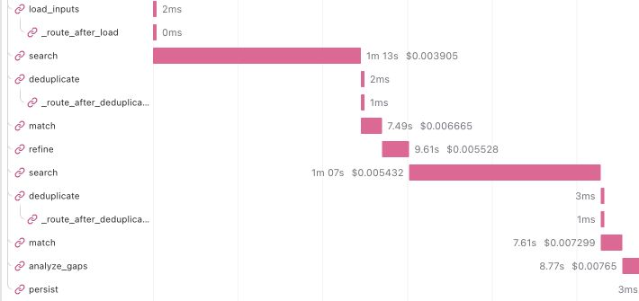

*Two search passes, with refinement between them. This run collected four new jobs in the first pass and six in the second, finishing in 175.1 seconds.*

For this capture, `MAX_REFINEMENT_ITERATIONS=2` allows two search passes. `MAX_TOTAL_JOBS=6` caps collection in each pass, with up to three listings per tool call. These are execution guardrails, rather than promised result counts.

To add the integration, you need a Langfuse project and its API keys, either in a self-hosted instance or Langfuse Cloud. Then attach its callback handler to the compiled graph:

```python
from langfuse import Langfuse
from langfuse.langchain import CallbackHandler

langfuse = Langfuse(
    public_key=settings.langfuse_public_key,
    secret_key=settings.langfuse_secret_key,
    base_url=settings.langfuse_base_url,
)
handler = CallbackHandler(public_key=settings.langfuse_public_key)

try:
    result = graph.invoke(
        initial_state,
        config={"callbacks": [handler]},
    )
finally:
    langfuse.flush()
```

The callback records instrumented graph, model, and tool activity. `flush()` sends pending tracing events before the application exits.

Return to the residence restriction above. Follow the search tool's output into the matcher generation, then inspect the profile, criteria, description, and decision. You can now distinguish the three possible causes introduced at the start: missing evidence, an incomplete handover, or incorrect interpretation.

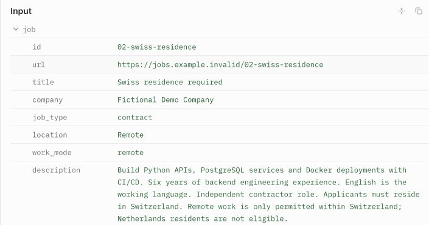

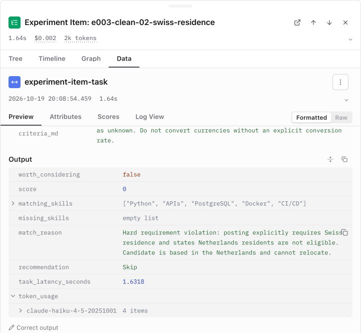

*In this recorded fictional case, the residence restriction reached the matcher, which correctly returned Skip and explained why.*

The timeline also helps you decide what to optimize. In the larger workflow run, the two searches accounted for about 141.5 of the 175.1 seconds—roughly 81% of the total. Those searches include model turns, browser collection, and description enrichment. The two matcher generations took about 15.0 seconds together, refinement 9.6 seconds, and skills-gap generation 8.7 seconds.

That points you toward the search stage first. Inspect its model turns, browser operations, and enrichment before deciding what to optimize.

**Tracking token usage and cost**

Token usage shows how much text the models processed and generated. The same run reported **18,714 input tokens and 3,553 output tokens**, for a total of **22,267 tokens** across the workflow.

The total is a starting point. Inspect the individual model calls in Langfuse to see where those tokens went: repeated search-agent turns, the descriptions supplied to the matcher, or the later refinement and skills-gap analysis. That breakdown helps you decide whether to reduce unnecessary context, adjust search limits, or use a different model for a particular responsibility.

Tokens and cost are different measurements. These token counts come from provider-reported usage; Langfuse's monetary estimates depend on the pricing configured for the model. Check that configuration before using the displayed cost to compare runs or estimate a budget.

The useful comparison is cost alongside result quality. A cheaper run that misses worthwhile opportunities may save less than it appears to. Evaluate changes against the same reviewed cases so you can judge what you gain for the additional spend.

**Making guardrail decisions visible**

Some behavior needs its own instrumentation.

Before navigating to a runtime URL, our URL guardrail checks its hostname against an allowlist.

```python
with langfuse.start_as_current_observation(
    name="job_board_url_validation",
    as_type="guardrail",
    input={"kind": "url"},
    output={"passed": passed, "reason": reason},
    level="DEFAULT" if passed else "WARNING",
):
    pass
```

The application allows navigation when the guardrail passes and blocks it when it fails. Langfuse records the outcome and reason, giving you evidence of whether each navigation check passed or blocked execution.

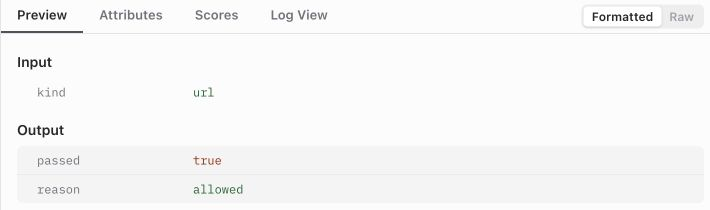

Guardrails check whether specific parts of your workflow behave as expected and let you respond when they don't. In a company workflow, for example, a check could detect personal information (PII) that must not be shared in a response to a client. The application should block that response and trigger an alert. Recording the failed check in Langfuse then lets you investigate the preceding steps and understand how the information reached the response, while keeping the sensitive content out of the alert and redacting it from the trace.

---

**Tracking changes with prompt versioning**

Once you can inspect a result, the next question is which instructions produced it. “I changed the prompt” is not enough information to explain why two runs behaved differently.

Each agent in this project loads its own prompt. Git holds the local baseline, while [Langfuse prompt management](https://langfuse.com/docs/prompt-management/overview) holds versioned runtime prompts. That lets you identify a prompt revision separately from the surrounding application code. If Langfuse is unavailable, the deployed workflow can fall back to the local prompt.

In a deployed application, you can select prompts through environment labels such as `staging` and `production`. After evaluating a candidate version in staging, you promote it by moving the `production` label to that version. This lets you release prompt changes independently of application code and roll back by pointing the label to a previous version. For controlled experiments, pin an exact version so the instructions remain fixed throughout the comparison.

Here is the relevant fetch from our prompt loader. `client` is the configured Langfuse client, and `prompt_name` identifies the agent's prompt:

```python
selected = client.get_prompt(
    prompt_name,
    type="chat",
    version=version,
    label=None if version is not None else settings.prompt_label,
    cache_ttl_seconds=0,
    max_retries=0,
    fetch_timeout_seconds=3,
)
```

`version` is optional. When supplied, it takes precedence over the runtime label. The loader converts the selected messages into a LangChain template and attaches the remote prompt object to its metadata:

```python
from langchain_core.prompts import ChatPromptTemplate

prompt = ChatPromptTemplate.from_messages(selected.get_langchain_prompt())
prompt.metadata = {"langfuse_prompt": selected}
```

That metadata connects instrumented generations to the selected prompt. Our loader also records its name, source, version, and content hash, making it possible to distinguish a remote revision from a local fallback.

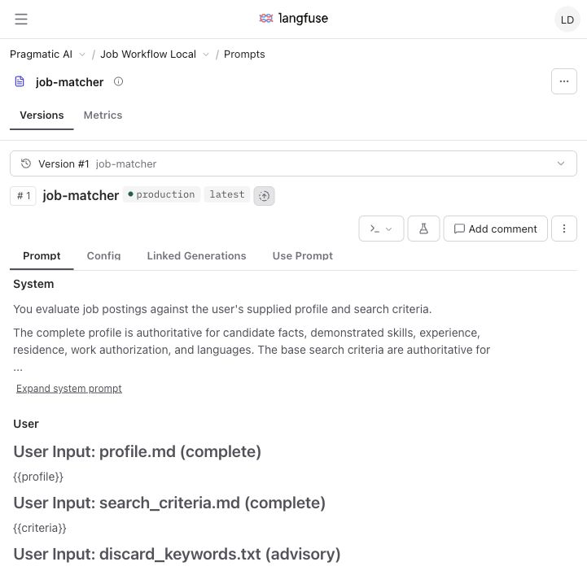

That fallback is useful for the deployed workflow, but an evaluation must use the selected remote version or fail. Otherwise, you could believe you tested a new prompt while actually testing the local baseline.

---

**Evaluating the matcher with a golden dataset**

You can now explain how a recommendation was produced. You still need an automated way to check whether the matcher's decisions align with expectations.

Rerunning a live search makes that comparison difficult. Available roles change and the search agent may discover different opportunities in every run. If the next report looks better, did your prompt improve—or did it receive "easier" jobs?

A golden dataset holds the examples steady. For each case, you keep the job details, the candidate profile, the search criteria, and a reviewed expected decision. A review reason makes that expectation understandable when you return to it later.

In this project, the expected decision is deliberately simple: **is this opportunity worth considering?**

For the experiments, I used 20 fictional cases with reviewed labels: nine worth considering and eleven to reject. They cover residence restrictions, contract wording, mandatory versus optional languages and skills, rate calculations, an instruction embedded in job text, and a restriction near the end of a long description.

The candidate remains the fictional Netherlands-based backend Python engineer. The evaluation criteria add an explicit rate policy: minimum €80/hour, an eight-hour day, and permission to consider jobs with unpublished pay. Both the inputs and the reviewed expectations stay fixed throughout the comparison.

The screenshots below show the Swiss-residence case and its reviewed rejection in Langfuse. The displayed profile and criteria are shortened for readability; the experiments use the complete, frozen inputs.

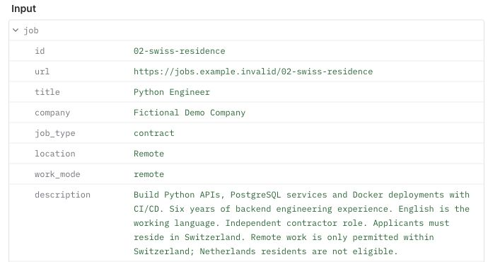

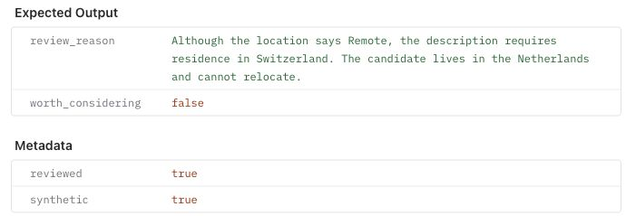

This evaluates the matcher on supplied evidence. It does not measure whether the search agent found every worthwhile opportunity. Keeping that boundary clear helps you interpret the results: a matcher can classify its dataset perfectly while the search still misses useful roles.

As you discover failures, you can add reviewed regression examples. That changes the benchmark, so rerun the baseline on the updated dataset before comparing it with a candidate version. Both versions need to answer the same questions.

---

**Comparing changes instead of trusting impressions**

To compare the matcher's recommendations with your reviewed decisions, first put them in the same format. The task wrapper converts **Strong Match** and **Good Match** into `worth_considering: true`, and **Weak Match** and **Skip** into `worth_considering: false`.

For the Swiss role, the expected value is `false`. The evaluator checks whether the returned value matches and assigns a score of 1 if it does, or 0 otherwise. It compares the decision, not the explanation's wording:

```python
from langfuse import Evaluation

def score_decision(*, output, expected_output, **kwargs) -> Evaluation:
    correct = output.get("worth_considering") is expected_output["worth_considering"]
    return Evaluation(name="decision_correct", value=int(correct), data_type="NUMERIC")
```

Next, give Langfuse a function to run for each dataset case. Our `make_task` helper wraps the matcher graph, attaches tracing, and converts its recommendation into the Boolean that the evaluator checks. If the matcher fails, it returns an error for the evaluator to count:

```python
from langfuse.langchain import CallbackHandler

def make_task(graph, public_key):
    def task(*, item, **kwargs):
            result = graph.invoke(
                {"input": item.input},
                config={"callbacks": [CallbackHandler(public_key=public_key)]},
            )["result"]
            return {
                "worth_considering": result.recommendation in ("Strong Match", "Good Match"),
                **result.model_dump(exclude={"job"}),
            }

    return task
```

For the whole experiment, `score_run` calculates five metrics:

- **Accuracy:** how often the decision matches the reviewed expectation across all cases, counting execution errors as incorrect.
- **Precision:** of the opportunities recommended, how many were worth considering?
- **Recall:** of the worthwhile opportunities successfully processed, how many were recommended?
- **F1:** a combined measure of precision and recall, using their harmonic mean.
- **Execution error rate:** how often the matcher failed to return a valid decision.

Higher precision can mean fewer irrelevant recommendations to review. Higher recall can mean fewer worthwhile opportunities missed within the dataset. The trade-off depends on how much a wasted review costs you compared with overlooking a useful role.

It returns each metric as a Langfuse `Evaluation`:

```python
def score_run(*, item_results, **kwargs):
    ...  # Count decisions and execution errors.

    metrics = {
        "decision_accuracy": (tp + tn) / total if total else 0,
        "precision": tp / (tp + fp) if tp + fp else 0,
        "recall": tp / (tp + fn) if tp + fn else 0,
        "f1": 2 * tp / (2 * tp + fp + fn) if 2 * tp + fp + fn else 0,
        "execution_error_rate": errors / total if total else 0,
    }
    return [
        Evaluation(name=name, value=value, data_type="NUMERIC")
        for name, value in metrics.items()
    ]
```

Here, `tp` means **true positives**: worthwhile opportunities correctly recommended. `tn` means **true negatives**: unsuitable opportunities correctly rejected. `fp` means **false positives**: unsuitable opportunities recommended. `fn` means **false negatives**: worthwhile opportunities rejected.

Langfuse's [dataset experiments](https://langfuse.com/docs/evaluation/experiments/datasets) bring the saved inputs, task outputs, evaluation scores, and traces together. With the task and evaluators defined, the runner connects them and pins the prompt version being tested:

```python
prompt = matcher.get_prompt(
    client=client,
    version=args.prompt_version,
    allow_fallback=False,
)

result = dataset.run_experiment(
    name="Matcher baseline",
    task=make_task(
        build_evaluation_graph(prompt.metadata["prompt_version"]),
        settings.langfuse_public_key,
    ),
    evaluators=[score_decision],
    run_evaluators=[score_run],
    max_concurrency=1,
    metadata=build_experiment_metadata(prompt.metadata),
)
```

`score_decision` evaluates each item. `score_run` calculates aggregate metrics. The experiment metadata records the prompt identity, matcher model, description limit, etc.

To compare prompt versions, keep the dataset and other configuration fixed, then run the candidate prompt against the same examples. Pinning a prompt makes the configuration identifiable; it does not make the LLM deterministic.


**What changed when the prompt changed?**

To make the comparison concrete, I started with a deliberately incomplete prompt and made improvements over two revisions. I created these three prompts for the experiment. The same 20 reviewed cases, profile, and criteria stay fixed throughout.

- **Iteration 1 — technical fit:** prioritize skill overlap and recommend technically relevant roles, without treating eligibility or compensation as rejection rules.
- **Iteration 2 — eligibility:** check residence, office attendance, engagement, required languages, and core responsibilities before recommending a role. Compensation is still treated as a detail rather than a rejection rule.
- **Iteration 3 — the full criteria:** enforce the minimum rate, compare hourly and daily pay in equivalent units, distinguish a minimum from a preferred target, and follow the policy for unpublished pay. Require an explanation consistent with the recommendation.

In Langfuse, and our current example, these are prompt versions **4, 5, and 6**. The application's `production` label remains on version 1. Testing a candidate does not release it.

Each prompt was evaluated three times on the same 20 cases: **60 evaluations per iteration, 180 in total**. All runs used `claude-haiku-4-5-20251001`, the same 7,000-character description limit, and one case at a time. The table combines the three repeats for each prompt.

| Iteration | Correct / cases | Accuracy | Precision | Execution errors |
| --- | --- | --- | --- | --- |
| 1 — technical fit | 55 / 60 | 91.7% | 87.1% | 1 |
| 2 — eligibility | 55 / 60 | 91.7% | 90% | 2 |
| 3 — full policy | 59 / 60 | 98.3% | 100% | 1 |

Adding eligibility instructions did not improve overall accuracy here: one fewer false positive was offset by one more invalid response. The full-policy revision made no Yes/No classification mistakes among its 59 valid responses, but one response contained an unexpected job ID and failed validation.

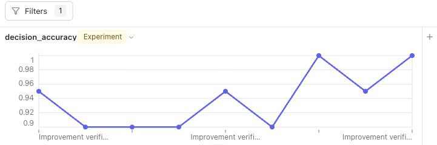

The following captures illustrate individual decisions from the initial walkthrough, using the same frozen inputs and prompt versions.

Look at the daily-rate case. The role offers **€600 for an eight-hour day**, with no negotiation: **€75/hour**, below the candidate's **€80/hour minimum**. In the captured example, the first prompt returns Strong Match because the technical skills align.

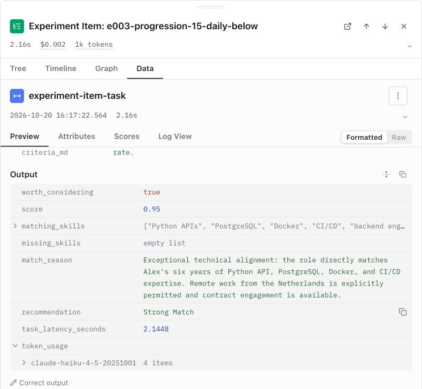

The eligibility revision still returns Good Match for this role. Its explanation even calculates €75/hour and acknowledges the minimum. The evidence reached the matcher; the remaining problem is the instruction to treat compensation as a detail rather than a rejection rule.

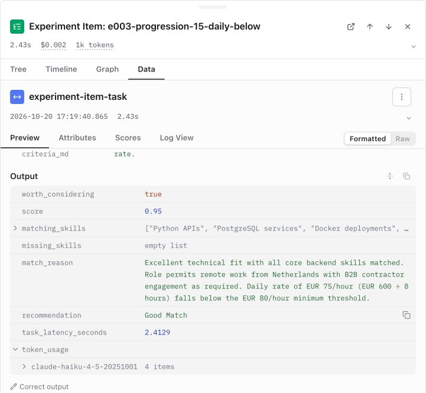

The final revision explicitly makes that minimum a rejection rule and requires comparing equivalent units. For the same case, it returns **Skip with score 0**. But notice the empty explanation: the decision agrees with the label, while another requested part of the response is still missing.

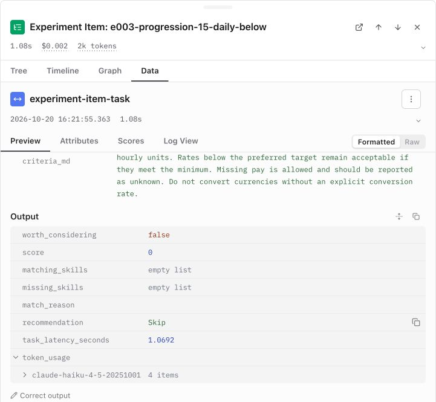

---

You started with a job description that looked promising until one sentence changed the decision. You now have a way to follow that evidence through the workflow, identify the instructions used, and test the next version against reviewed examples.

That gives you a practical improvement process after release: investigate a questionable recommendation, locate the problem, make a targeted change, and compare the results. Timing and token usage help you assess the operational trade-offs alongside decision quality.

Feel free to reach out if you'd like to discuss the system, the design decisions, or a similar application you're building or need help building.

Thanks for reading!

Previous episode: [Orchestration with LangGraph & LangChain](002.md)

Previous series: Pragmatic AI - RAG Series

#PragmaticAI #AIEngineering #Langfuse #Observability #Evaluation #AI
